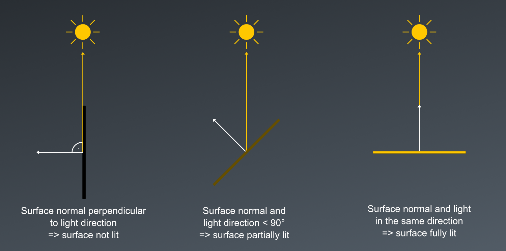

# Lesson 30: Diffuse lighting I (flat shading)

In the last lesson we gave our scene a bit of ambient light. That's a good start, as we can now control the overall brightness and light color for the whole scene. However, it doesn't create any sense of depth, let alone realistic results: all six faces are lit equally, no matter which way they point. Rotate the cube and nothing about the shading changes - the faces are only distinguishable because we gave them different colors. Take those colors away and our three-dimensional object collapses into a flat silhouette. This is what I want to address today by implementing the first version of a concept called diffuse lighting.

Before we go there though, I want to upgrade our geometry a bit. The cube has served us well so far, but to really be able to observe the effects of our lighting models, a more complex shape is better suited. So let's replace the cube with a sphere.

## Building a sphere
The good thing about a sphere is that we can generate its geometry algorithmically. The usual way to do so is to treat it like a globe and cut it along lines of latitude and longitude[^1]. We walk from one pole to the other in a number of horizontal rings, which I'll call *stacks*, and around each of those rings in a number of steps, which I'll call *slices*. Between two neighboring rings and two neighboring slice steps lies a small quad, which we'll model as two triangles - exactly like the faces of our cube, just a great many more of them.

A point on that grid is described by two angles: `phi`, which runs from 0 at one pole to π at the other, and `theta`, which runs from 0 all the way around to 2π. So a point on the surface of the sphere can be calculated as:

```text
x = radius * sin( phi ) * cos( theta )
y = radius * cos( phi )
z = radius * sin( phi ) * sin( theta )
```

Which translates into code almost literally:

```cpp
// main.cpp
auto sphereSurfacePoint( float radius, float phi, float theta ) -> glm::vec3
{
    return radius * glm::vec3{
        std::sin( phi ) * std::cos( theta ),
        std::cos( phi ),
        std::sin( phi ) * std::sin( theta )
    };
}
```

With that in place, we can write the generator function itself. We walk the grid quad by quad. For each quad, we compute its four corners and pass the corners of its two triangles to a small helper function, `addTriangle`:

```cpp
// main.cpp
auto addTriangle(
    std::vector< Vertex >& vertices,
    const glm::vec3& a,
    const glm::vec3& b,
    const glm::vec3& c,
    const glm::vec4& color
) -> void
{
    vertices.push_back( Vertex{ glm::vec4{ a, 1.f }, color } );
    vertices.push_back( Vertex{ glm::vec4{ b, 1.f }, color } );
    vertices.push_back( Vertex{ glm::vec4{ c, 1.f }, color } );
}

auto createSphere(
    float radius,
    std::uint32_t numStacks,
    std::uint32_t numSlices,
    const glm::vec4& color
) -> std::vector< Vertex >
{
    assert( numStacks >= 2 && numSlices >= 3 );

    auto vertices = std::vector< Vertex >{};
    vertices.reserve( 6u * numStacks * numSlices );

    const auto angleOf = []( std::uint32_t step, std::uint32_t numSteps, float fullAngle ) -> float
    {
        return fullAngle * static_cast< float >( step ) / static_cast< float >( numSteps );
    };

    // sin( π ) and sin( 2π ) aren't exactly 0 in floating point, so we set the bottom pole and
    // the closing angle of the last slice explicitly to make neighboring triangles share
    // bit-identical vertices.
    const auto bottomPole = glm::vec3{ 0.f, -radius, 0.f };

    for ( std::uint32_t stack = 0; stack < numStacks; ++stack )
    {
        const auto isFirstStack = stack == 0;
        const auto isLastStack = stack + 1 == numStacks;

        const auto phiTop = angleOf( stack, numStacks, glm::pi< float >() );
        const auto phiBottom = angleOf( stack + 1, numStacks, glm::pi< float >() );

        for ( std::uint32_t slice = 0; slice < numSlices; ++slice )
        {
            const auto isLastSlice = slice + 1 == numSlices;

            const auto thetaLeft = angleOf( slice, numSlices, glm::two_pi< float >() );
            const auto thetaRight = isLastSlice ? 0.f : angleOf( slice + 1, numSlices, glm::two_pi< float >() );

            const auto topLeft = sphereSurfacePoint( radius, phiTop, thetaLeft );
            const auto topRight = sphereSurfacePoint( radius, phiTop, thetaRight );
            const auto bottomLeft = isLastStack ? bottomPole : sphereSurfacePoint( radius, phiBottom, thetaLeft );
            const auto bottomRight = isLastStack ? bottomPole : sphereSurfacePoint( radius, phiBottom, thetaRight );

            // At the poles the whole ring collapses into a single point, so one of the two
            // triangles of those quads would have no area at all.
            if ( !isFirstStack )
                addTriangle( vertices, topLeft, topRight, bottomLeft, color );

            if ( !isLastStack )
                addTriangle( vertices, topRight, bottomRight, bottomLeft, color );
        }
    }

    return vertices;
}
```

The poles are the one place where the neat grid breaks down, because the quads touching a pole degenerate into triangles: their top (or bottom) edge collapses into a single point. That's what the two `if`s are there for. Emitting those triangles anyway wouldn't be a catastrophe, since they have no area and the rasterizer would throw them away without drawing a single pixel. But it's still better to just not generate them.

You may also have noticed that we don't simply calculate every corner with `sphereSurfacePoint`: the bottom pole and the right edge of the last slice get special treatment. This is to avoid tiny cracks in our sphere[^2]. The `assert` at the top makes sure we get at least a minimal sphere: with fewer than two stacks, every triangle would be skipped, and with fewer than three slices, the result would have no volume.

We've already made our rendering pipeline able to handle any (or even a changing) number of vertices, so all that's left to do now is to replace the cube's vertex definitions in `main()`:

```cpp
// main.cpp
...
constexpr auto sphereRadius = .7f;
constexpr std::uint32_t numSphereStacks = 24u;
constexpr std::uint32_t numSphereSlices = 24u;
constexpr auto sphereColor = glm::vec4{ 0.5f, 0.5f, 0.5f, 1.f };

const auto vertices = createSphere( sphereRadius, numSphereStacks, numSphereSlices, sphereColor );
const auto vertexCount = static_cast< std::uint32_t >( vertices.size() );
...
```

Compile and run this, and you'll see that the cube has been replaced by a pulsating, color-changing disc. I chose a neutral gray so that the effect of the lighting will be easy to see. As described at the beginning, ambient light alone gives the eye no clue about the orientation of a surface, so the sphere can't be told apart from a flat disc. That's what I want to change now.

## Diffuse shading
In the real world, a surface's orientation relative to the light source(s) matters a lot. A face turned toward a light catches more of it; a face turned away catches less. These differences in brightness are what our eyes rely on to perceive shape and depth.

Many everyday surfaces - paper, chalk, unfinished wood - are matte: when light hits them, they scatter it back out roughly equally in all directions rather than reflecting it like a mirror. This is called diffuse reflection, and it has a convenient consequence: how bright such a surface appears depends only on how much light reaches it, not on where we happen to be looking from. And for a given light, the amount a surface receives depends on its orientation relative to that light.

Mathematically, we can simulate diffuse reflection by calculating the dot product of two normalized vectors: the surface normal **N**, and the light direction **L**, which points from the surface toward the light source. For normalized vectors, the dot product equals the cosine of the angle between them, and that's exactly how the received light falls off: the further a surface tilts away from the light, the larger the area the same amount of light is spread over. If N and L point in exactly the same direction, the dot product is 1 and the light contributes fully. If they are perpendicular, the result is 0, and this particular light source doesn't light the surface at all.



If the normal points more than 90° away from the light direction, the dot product becomes negative. A surface can't receive negative light, though, so we clamp the result to 0. That gives us the formula for the diffuse component:

```text
diffuse = max( dot( N, L ), 0 )
```

This is known as the *Lambert term*. In the classic Phong reflection model, it's the second of three components: ambient, diffuse, and specular.

On its own, the Lambert term is just a factor between 0 and 1 that tells us how strongly a surface is lit. To get the actual diffuse light, we multiply it by the light's color, and then multiply the result by the surface color - just like we did with the ambient term in the last lesson:

```glsl
vec3 diffuse = max( dot( N, L ), 0.0 ) * lightColor;
outColor = vec4( ( ambient + diffuse ) * objectColor.rgb, objectColor.a );
```

One decision we have to make now is _where_ in the pipeline we want to evaluate that formula. We have two candidates: the vertex shader, which runs once per vertex, or the fragment shader, which runs once per fragment (roughly, once per pixel covered by a triangle). Looking at the Lambert term, this only makes a difference if N or L vary across a triangle. In more advanced lighting systems they do, but we'll start with the simple case and assume that both are constant for each triangle.

For L, that means we'll use a *directional light*: a light source so far away - like the sun - that its light hits every point of the scene from the same direction. For N, it means that each triangle gets one single normal. This is known as *flat shading*, and it means that each triangle will be lit uniformly and end up with a single color. So for now, we can evaluate the formula in the vertex shader.

Let's implement this for our sphere.

---

[^1]: A latitude/longitude sphere like ours is the easiest one to derive, but it isn't the only option, and it does have the drawback that its triangles come out wildly uneven in size: tiny slivers crowding around the poles, comparatively huge ones at the equator. The common alternative is an icosphere, built by starting from an icosahedron and repeatedly subdividing each of its triangles into four. That gives you an almost uniform distribution of triangles over the whole surface and no poles to special-case, at the cost of less obvious code - which is why we're not building one here.

[^2]: The GPU's rasterization rules guarantee that two triangles sharing an edge leave no gap between them, but only if the shared vertices are bit-for-bit identical. Floating-point math doesn't give us that for free: `std::sin( glm::two_pi< float >() )` is about `-1.7e-7`, not 0, so the vertices along the seam at `theta = 2π` would end up slightly off from the ones at `theta = 0`. The same happens at the bottom pole. The deviations are tiny, but they can occasionally show up as single-pixel holes along the seam. Using `0` as the closing angle of the last slice and setting the bottom pole explicitly removes the problem. The top pole doesn't need this, because `sin( 0 )` is exactly 0.
